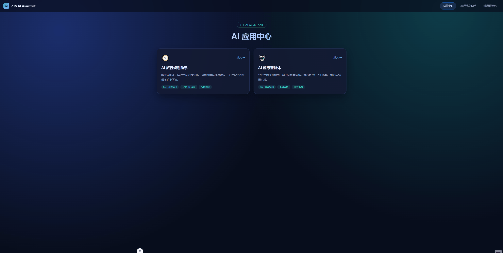
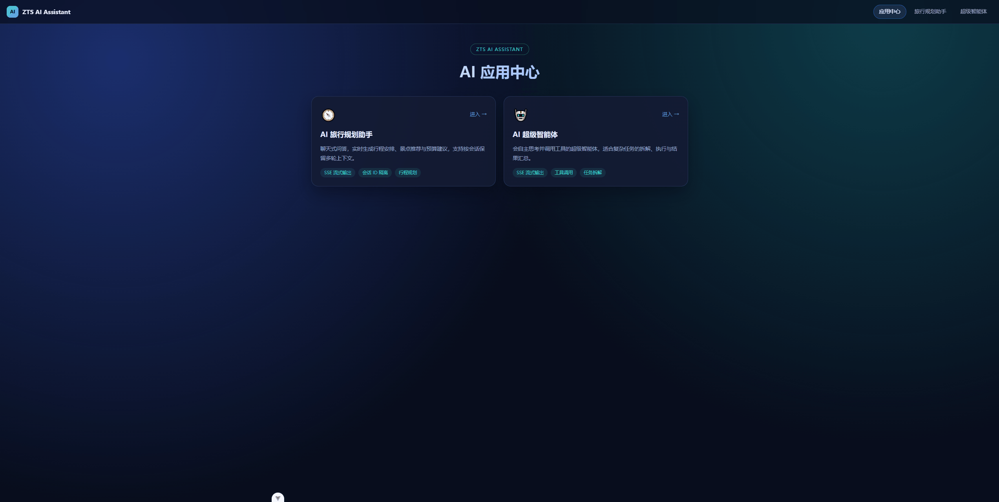
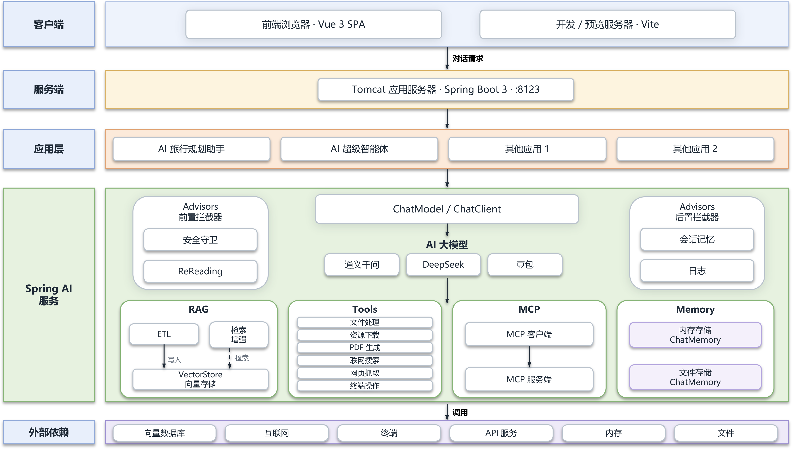
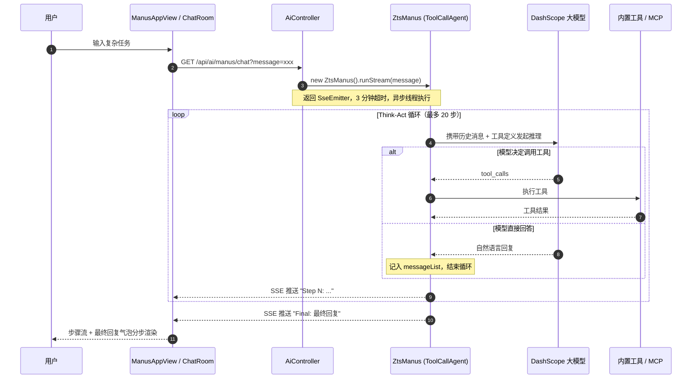

# ZTS AI Assistant ·  AI 应用开发实战

> 一个基于 **Spring Boot 3 + Spring AI Alibaba + Vue 3** 的全栈 AI 应用项目，覆盖大模型对话、SSE 流式输出、RAG 检索增强、Tool Calling、MCP 协议接入与 ReAct 自主智能体等主流 AI 工程能力。

<p align="left">
  
  
  
  
  
  
  <!-- 已选择开源协议后再启用： -->
</p>

---

## 📖 项目简介

**ZTS AI Assistant** 是我在学习 AI 应用过程中实践的一个「AI 应用开发全家桶」项目。它不是一个只会聊天的 Demo，而是把目前企业落地 AI 应用最常用的几种范式，用一套可运行的代码完整串了起来：

- **对话式应用**：有角色人设、有长期记忆、能多轮追问；
- **流式体验**：SSE 逐字返回，首字延迟从「等待模型返回全部输出内容」变成「感觉即时响应」；
- **知识增强（RAG）**：让模型回答本地知识库中的特定领域知识，而不是一本正经地胡说；
- **工具调用（Function Calling / MCP）**：让模型能联网搜索、爬网页、读写文件、生成 PDF，以及调用高德地图这类第三方 MCP 服务；
- **自主智能体（Agent）**：让模型自己拆解任务、决定下一步、循环执行直到完成——即「手写一个 Manus」。

项目采用前后端分离：后端提供 AI 能力与 SSE 流式接口，前端是一个应用中心，可以在「AI 旅行规划助手」和「AI 超级智能体」之间自由切换。

## ✨ 项目特性

| 特性 | 说明 |
| --- | --- |
| 🎯 双 AI 应用 | 垂直场景的「AI 旅行规划助手」+ 通用任务的「AI 超级智能体」 |
| 🧠 多轮会话记忆 | 基于 `ChatMemory` + 会话 ID 隔离上下文，支持内存 / 文件（Kryo 序列化）两种持久化实现 |
| 📚 RAG 知识库 | Markdown 文档加载 → 自动关键词元信息增强 → 向量检索 → 上下文注入，支持 `SimpleVectorStore` 与 **PgVector** 双实现 |
| 🛠️ 6 大内置工具 | 文件读写、网页搜索、网页抓取、资源下载、PDF 生成、主动终止 |
| 🔌 MCP 协议 | 同时支持 **SSE** 与 **Stdio** 两种 MCP 客户端接入方式 |
| 🤖 ReAct 智能体 | 自主实现 `BaseAgent → ReActAgent → ToolCallAgent → ZtsManus` 四层抽象，Think-Act 循环执行 |
| 📋 结构化输出 | 基于 `entity()` + JSON Schema，把大模型输出直接映射为 Java 对象 |
| 📄 接口文档 | 集成 Knife4j / OpenAPI 3，开箱即用的中文调试界面 |
| 🎨 现代化前端 | Vue 3 组合式 API + TypeScript + Pinia + Vue Router，SSE 流式对话组件化封装 |

## 🖼️ 界面预览

### AI 旅行规划助手

<div align="center">
	
	<sub>提问后经 SSE 逐字返回；按会话 ID 保留多轮上下文，渐进式生成行程建议</sub>
</div>


### AI 超级智能体

<div align="center">
	
	<sub>智能体自主思考并调用工具，每一步以「步骤流」实时展示，最终汇总为「最终回复」</sub>
</div>

## 🏗️ 项目架构

### 项目架构设计图

整体自上而下分为 **客户端 → 服务端 → 应用层 → Spring AI 服务 → 外部依赖** 五层，与本项目的实际包结构一一对应。



> **关于模型厂商**：图中列出通义千问 / DeepSeek / 豆包三条主流适配线路，得益于 Spring AI 的 `ChatModel` 抽象层，切换厂商只需替换 starter 与配置；本项目当前实际接入的是**阿里云百炼 DashScope（通义千问）**。
>
> **关于未实现项**：`小程序 / 桌面 APP`、`Serverless / Docker 部署` 属后续规划，为避免误导，上图中未包含它们；`其他应用 1 / 2` 是扩展位，新增应用只需在 `AiController` 增加端点、在 `HomeView` 追加卡片配置。

### 架构层与代码包对照

| 架构层 | 图中元素 | 对应代码位置 |
| --- | --- | --- |
| **客户端** | 前端浏览器（Vue 3 SPA） | `zts-ai-assistant-frontend/src/views`、`components/ChatRoom.vue`、`utils/sse.ts` |
| **服务端** | Tomcat 应用服务器（:8123） | `ZtsAiAssistantApplication`、`controller/`、`config/CorsConfig` |
| **应用层** | 旅行助手 / 超级智能体 / Agent 抽象 | `app/TravelAPP`、`agent/ZtsManus`、`agent/BaseAgent ⇢ ReActAgent ⇢ ToolCallAgent` |
| **Advisors 拦截器链** | 前置 / 后置拦截器 | `advisor/MyLoggerAdvisor`、`MessageChatMemoryAdvisor`、`QuestionAnswerAdvisor` |
| **ChatClient ** | ChatModel / ChatClient、AI 大模型 | `spring-ai-alibaba-starter-dashscope`、`TravelAPP` 中构建的 `ChatClient` |
| **RAG** | ETL、检索增强、VectorStore | `rag/TravelAppDocumentLoader`、`rag/MyKeywordEnricher`、`rag/QueryRewriter`、`rag/TravelAppVectorStoreConfig`、`rag/PgVectorVectorStoreConfig` |
| **Tools** | 文件 / 下载 / PDF / 搜索 / 爬取 / 终止 | `tools/` 下 6 个工具类 + `tools/ToolRegistration` |
| **MCP** | MCP 客户端 / 服务端 | `mcp-servers.json`、`TravelAPP#doChatWithMcp` |
| **Memory** | 内存 / 文件存储 | `InMemoryChatMemoryRepository`、`chatmemory/FileBasedChatMemory`、`chatmemory/FileChatMemoryRepository` |
| **外部依赖** | 向量库 / 互联网 / 终端 / API / 内存 / 文件 / 数据库 | PostgreSQL + pgvector、SearchAPI.io、`TerminalOperationTool`、高德地图 MCP、`FileConstant.FILE_SAVE_DIR` |

### 请求时序图（以 AI 超级智能体为例）



### 后端分层

```
com.zts.ztsaiassistant
├── agent                  # 智能体体系
│   ├── BaseAgent          #   抽象基类：状态机（IDLE/RUNNING/FINISHED/ERROR）、
│   │                      #   消息上下文、maxSteps 执行循环、同步 run() 与流式 runStream()
│   ├── ReActAgent         #   Think-Act 范式抽象，step() = think() + act()
│   ├── ToolCallAgent      #   接管工具调用：禁用 Spring AI 内置执行、自主维护
│   │                      #   ToolCallingManager 与上下文，识别 terminate 工具结束任务
│   ├── ZtsManus           #   超级智能体实现（系统提示词 + 下一步提示词 + 最大 20 步）
│   └── model/AgentState   #   智能体状态枚举
├── app/TravelAPP          # 垂直场景应用：基础对话、结构化报告、RAG 问答、工具调用、MCP 调用
├── rag                    # 检索增强：文档加载器、关键词增强器、查询重写、
│                          #   SimpleVectorStore / PgVector 双向量库配置、自定义 Advisor 工厂
├── chatmemory             # 对话记忆：FileBasedChatMemory（Kryo）、FileChatMemoryRepository
├── tools                  # 工具集：文件、搜索、爬虫、下载、PDF、终止 + 集中注册
├── advisor/MyLoggerAdvisor# 自定义 Advisor：打印请求与响应，便于调试
├── controller             # AiController（AI / SSE 接口）、HealthController
├── config/CorsConfig      # 跨域配置
└── constant/FileConstant  # 文件输出根目录常量
```

## 🧩 功能模块

### 1. AI 旅行规划助手 —— 垂直场景对话应用

以「小旅」为角色人设的资深旅游规划顾问，通过多轮对话逐步了解用户，最终定制行程。

后端 `TravelAPP` 以渐进式的方式展示了 AI 对话应用的完整能力矩阵：

| 能力 | 方法 | 技术要点 |
| --- | --- | --- |
| 基础多轮对话 | `doChat` | `ChatClient` + `MessageChatMemoryAdvisor`，按 `chatId` 隔离会话 |
| SSE 流式对话 | `doChatByStream` | `.stream().content()` 返回 `Flux<String>` |
| 结构化输出 | `doChatWithReport` | `.entity(TravelReport.class)` 直接映射为 Java Record |
| RAG 知识库问答 | `doChatWithRag` | 查询重写 + `QuestionAnswerAdvisor` 向量检索增强 |
| 工具调用 | `doChatWithTools` | `.toolCallbacks(allTools)` 注入本地工具 |
| MCP 服务调用 | `doChatWithMcp` | `ToolCallbackProvider` 接入 MCP Server |

### 2. AI 超级智能体（ZtsManus）—— ReAct 自主智能体

这是本项目的核心模块：**自主实现 Manus 智能体**。

```
BaseAgent      抽象基类   → 状态管理、消息上下文、maxSteps 循环、流式推送
   ↓
ReActAgent     范式抽象   → 把一步执行拆成 think() + act()
   ↓
ToolCallAgent  能力实现   → 解析 tool_calls、调用工具、回填结果、识别终止信号
   ↓
ZtsManus       业务实现   → 提示词编排 + 工具注册 + 最大 20 步
```

**执行循环的核心设计：**

1. `think()`：把历史消息 + 当前「下一步提示词」交给模型，解析出模型想调用的工具；
2. `act()`：通过 `ToolCallingManager` 真正执行工具，并把 `conversationHistory` 回填为上下文；
3. 模型不再调用工具时，`think()` 返回 `false`，本步不再执行工具，由 `maxSteps` 上限或 `doTerminate` 工具调用结束整个循环；
4. 每一步结果都通过 `SseEmitter` 实时推送给前端，前端以「步骤流」形式渐进展示；
5. 达到 `maxSteps` 上限时自动终止，避免死循环与不可控的 Token 消耗；循环结束后统一推送模型最后一条助手消息作为「最终回复」。

> 💡 **为什么禁用 Spring AI 内置的工具执行？** `ToolCallAgent` 通过 `internalToolExecutionEnabled(false)` 关闭框架自动执行，由自己维护 `ChatOptions` 与消息上下文——这样才能把「每一步」暴露给 SSE 推送，并实现自定义的终止与步数控制。

### 3. RAG 检索增强

```
Markdown 文档（classpath:documents/*.md）
   ↓ TravelAppDocumentLoader  按水平分割线切块 + 注入 filename/status 元数据 + 生成稳定 UUID
   ↓ MyKeywordEnricher        用大模型为每个分块自动提取 5 个关键词作为元信息
   ↓ TravelAppVectorStoreConfig / PgVectorVectorStoreConfig   写入向量库
   ↓ QueryRewriter            查询重写：把口语化提问改写成更适合检索的查询
   ↓ QuestionAnswerAdvisor    相似度检索并注入上下文
   ↓ TravelAppRagCustomAdvisorFactory   进阶：按 status 过滤 + 相似度阈值 + topK + 空上下文兜底话术
```

两个工程化细节值得说明：

- **文档去重**：`TravelAppDocumentLoader` 用 `UUID.nameUUIDFromBytes(filename + index + text)` 生成**内容稳定 ID**，内容不变则 ID 不变，写入 PgVector 时命中 `ON CONFLICT` 覆盖，避免每次重启重复堆积向量数据；
- **空上下文兜底**：`allowEmptyContext(false)` + 自定义 `emptyContextPromptTemplate`，当知识库里检索不到相关内容时，模型会礼貌拒答而不是硬编造。

### 4. 工具箱（Function Calling）

| 工具 | 类名 | 能力 |
| --- | --- | --- |
| 文件读写 | `FileOperationTool` | 读写 UTF-8 文本文件 |
| 网页搜索 | `WebSearchTool` | 调用 SearchAPI.io 百度引擎，返回前 5 条结果 |
| 网页抓取 | `WebScrapingTool` | 基于 Jsoup 解析页面正文 |
| 资源下载 | `ResourceDownloadTool` | 下载网络资源到本地 |
| PDF 生成 | `PDFGenerationTool` | 基于 iText 生成 PDF，内置中文字体 |
| 主动终止 | `TerminateTool` | 智能体自主结束任务的信号工具 |

所有工具通过 `ToolRegistration` 集中注册为 `ToolCallback[]` Bean，`@Tool` / `@ToolParam` 注解的 description 会作为工具描述交给模型——**描述写得越清楚，模型选工具的准确率越高**。

### 5. MCP 协议接入

`mcp-servers.json` 中演示了两种 MCP Server 的接入方式：

```jsonc
{
  "mcpServers": {
    // Stdio 方式：以子进程启动本地 MCP Server
    "amap-maps": {
      "command": "cmd.exe",
      "args": ["/c", "npx", "-y", "@amap/amap-maps-mcp-server"],
      "env": { "AMAP_MAPS_API_KEY": "your-api-key" }
    },
    // Stdio 方式：启动自研的 Java MCP Server
    "zts-image-search-mcp-server": {
      "command": "java",
      "args": ["-Dspring.ai.mcp.server.stdio=true", "-jar", "target/zts-image-search-mcp-server-0.0.1-SNAPSHOT.jar"],
      "env": {}
    }
  }
}
```

同时 `application.yaml` 中保留了 SSE 方式连接的配置示例（`spring.ai.mcp.client.sse.connections`）。

> ⚠️ **注意**：`application.yaml` 里 MCP 客户端与 PgVector 的配置块目前是**注释状态**（默认以 `SimpleVectorStore` 跑通全流程），需要用到 MCP 或 PgVector 时请先取消对应注释。

### 6. 前端应用中心

| 页面 / 模块 | 说明 |
| --- | --- |
| `HomeView` | 应用中心首页，卡片式入口；新增应用只需追加一项配置 + 注册路由 |
| `TravelAppView` | 旅行规划对话页，内置 4 条引导示例问句 |
| `ManusAppView` | 智能体任务页，采用**步骤流模式**展示 Think-Act 过程 |
| `ChatRoom` | 通用对话组件：消息列表、流式光标、建议问句、请求中止、自动滚动 |
| `ChatMessageItem` | 消息气泡渲染，识别 `Final: ` 前缀单独渲染「最终回复」 |
| `utils/sse.ts` | 基于 `fetch + ReadableStream` 手写 SSE 解析器，支持 `AbortSignal` 中止 |
| `api/ai.ts` | 统一流式调用入口，流式不可用时自动降级为 axios 一次性取回 |
| `api/request.ts` | axios 实例封装 + 异常统一转换为可展示的中文错误文案 |

## 🛠️ 技术选型

### 后端

| 技术 | 版本 | 选型理由 |
| --- | --- | --- |
| Java | 21 | LTS 版本，Record / 虚拟线程等新特性 |
| Spring Boot | 3.5.8 | 生态成熟、自动装配、Web 与 SSE 支持完善 |
| Spring AI | 1.1.6 | 统一的 `ChatClient` / Advisor / VectorStore 抽象，屏蔽不同模型厂商差异（项目内 `spring-ai-*` 组件显式声明为 1.1.6，Alibaba 系列 starter 自带其兼容版本） |
| Spring AI Alibaba | 1.1.2.x | DashScope（通义千问）适配，`spring-ai-alibaba-agent-framework` 提供 Agent 能力参考 |
| DashScope SDK | 2.22.31 | 阿里云百炼原生 SDK，用于补充框架未覆盖的能力 |
| PostgreSQL + pgvector | - | 生产级向量存储，HNSW 索引 + 余弦距离；同时实现 `SimpleVectorStore` 用于本地快速验证 |
| Kryo | 5.6.2 | 高性能序列化，实现对话记忆的文件持久化 |
| iText | 9.1.0 | PDF 生成，支持内置中文字体 |
| Jsoup | 1.19.1 | HTML 解析与正文抽取 |
| Hutool | 5.8.37 | 国产工具库，简化 HTTP、文件、JSON 操作 |
| Knife4j | 4.4.0 | 基于 OpenAPI 3 的中文接口调试界面 |
| Lombok | - | 消除样板代码 |

### 前端

| 技术 | 版本 | 选型理由 |
| --- | --- | --- |
| Vue | 3.5 | 组合式 API，`<script setup>` 心智负担低 |
| TypeScript | 6.0 | 类型安全，接口契约清晰 |
| Vite | 8.2 | 极快的冷启动与 HMR |
| Pinia | 4.0 | 官方状态管理，轻量且类型友好 |
| Vue Router | 5.3 | 路由懒加载 + 标题管理 |
| Axios | 1.7 | 请求封装与统一错误处理 |
| ESLint + Oxlint + Prettier | - | 代码规范与格式化三件套 |

### 关键技术决策

| 决策 | 取舍说明 |
| --- | --- |
| **SSE 而非 WebSocket** | AI 对话是「一问多答」的单向推送场景，SSE 基于 HTTP、无需握手升级、天然支持断线重连，复杂度远低于 WebSocket |
| **前端手写 SSE 解析** | `EventSource` 只支持 GET 且无法自定义请求头、无法中止；改用 `fetch + ReadableStream` 可精确控制流读取并支持 `AbortSignal` |
| **自定义 Agent 而非直接用框架** | 为了把每一步过程暴露给前端、实现自定义终止与步数控制，需要自己接管工具执行链路 |
| **Advisor 链式增强** | 记忆、日志、RAG 全部以 Advisor 形式插拔，业务代码保持干净，能力可组合可开关 |
| **双向量库实现** | `SimpleVectorStore` 零依赖便于本地跑通与单元测试，`PgVectorStore` 面向生产持久化 |

## 📁 目录结构

```
zts-ai-assistant/                      # 仓库根目录
├── src/                               # 后端源码（Spring Boot）
│   ├── main/java/com/zts/ztsaiassistant/
│   │   ├── agent/                     # 智能体体系
│   │   ├── app/                       # 应用层（TravelAPP）
│   │   ├── rag/                       # RAG 检索增强
│   │   ├── tools/                     # 工具集
│   │   ├── chatmemory/                # 对话记忆持久化
│   │   ├── advisor/                   # 自定义 Advisor
│   │   ├── controller/                # REST / SSE 接口
│   │   └── config/                    # 配置类
│   ├── main/resources/
│   │   ├── application.yaml           # 主配置（端口 / Knife4j，已激活 local profile）
│   │   ├── application-local.yaml     # 本地密钥配置（已被 git 忽略，需自行创建）
│   │   ├── documents/                 # RAG 知识库 Markdown 文档
│   │   └── mcp-servers.json           # MCP Server 配置
│   └── test/java/                     # 单元测试
├── pom.xml                            # Maven 构建文件
├── zts-ai-assistant-frontend/         # 前端（Vue 3）
│   ├── src/
│   │   ├── api/                       # 接口封装
│   │   ├── components/                # ChatRoom / ChatMessageItem
│   │   ├── views/                     # 首页 / 旅行助手 / 智能体
│   │   ├── router/                    # 路由
│   │   ├── utils/                     # SSE 解析、流式工具
│   │   └── types/                     # 类型定义
│   ├── vite.config.ts                 # 开发代理 /api → :8123
│   └── package.json
├── docs/
│   ├── make_architecture_pptx.py      # 架构图生成脚本（python-pptx）
│   └── images/                        # README 配图（界面演示动图 / 截图）
│       ├── frontend_1.gif             # AI 旅行规划助手：对话与流式输出
│       ├── frontend_2.gif             # AI 超级智能体：Think-Act 步骤流
│       ├── architecture.pptx          # 架构图源文件（PPT，可编辑）
│       └── architecture.png           # 架构图导出图（README 引用）
└── README.md
```

## 🚀 快速开始

### 环境要求

| 依赖 | 版本要求 |
| --- | --- |
| JDK | 21+ |
| Maven | 3.8+ |
| Node.js | ^22.18.0 或 >=24.12.0 |
| pnpm / npm | 任意 |
| PostgreSQL | 可选，启用 pgvector 时需要（需安装 `vector` 扩展） |

### 1. 获取 API Key

| 服务 | 用途 | 获取地址 |
| --- | --- | --- |
| 阿里云百炼 DashScope | 对话模型 + 向量嵌入 | <https://bailian.console.aliyun.com/> |
| SearchAPI.io | 网页搜索工具 | <https://www.searchapi.io/> |

### 2. 创建本地配置

`application-local.yaml` 已被 `.gitignore` 忽略，需自行创建 `src/main/resources/application-local.yaml`：

```yaml
spring:
  ai:
    dashscope:
      api-key: 你的 DashScope API Key
      chat:
        options:
          model: qwen-plus        # 或你开通的其他模型
          multi-model: true       # 多模态端点开关，纯文本模型可关闭
  # 可选：启用 PgVector 时才需要
  datasource:
    url: jdbc:postgresql://localhost:5432/zts_ai_assistant
    username: your_user
    password: your_password

# SearchAPI 搜索工具
search-api:
  api-key: 你的 SearchAPI Key

server:
  port: 8123
  servlet:
    context-path: /api
```

> ⚠️ **安全提醒**：请勿把任何真实密钥提交到 Git 仓库。若密钥曾进入过版本历史，建议立即到控制台**重置密钥**。

### 3. 启动后端

```bash
# 项目根目录
./mvnw spring-boot:run          # macOS / Linux
mvnw.cmd spring-boot:run        # Windows

# 或打包运行
./mvnw clean package -DskipTests
java -jar target/zts-ai-assistant-0.0.1-SNAPSHOT.jar
```

启动后：

- 后端服务：<http://localhost:8123/api>
- 接口文档（Knife4j）：<http://localhost:8123/api/doc.html>

### 4. 启动前端

```bash
cd zts-ai-assistant-frontend

npm install        # 或 pnpm install
npm run dev        # 启动开发服务器，默认 http://localhost:5173
```

前端开发服务器已将 `/api` 代理到 `http://localhost:8123`，无需额外处理跨域。浏览器打开 <http://localhost:5173> 即可看到 AI 应用中心。

### 5. 生产构建

```bash
cd zts-ai-assistant-frontend
npm run build      # 产物输出到 dist/
npm run preview    # 本地预览构建产物
```

生产环境可通过 `.env.production` 指定后端地址：

```bash
VITE_API_BASE_URL=http://your-backend-host:8123/api
```

## 🔌 接口一览

后端统一前缀 `/api`（`server.servlet.context-path`）。

| 方法 | 路径 | 说明 |
| --- | --- | --- |
| GET | `/ai/travel_app/chat/sync` | 旅行助手同步对话 |
| GET | `/ai/travel_app/chat/sse` | 旅行助手 SSE 流式对话（`Flux<String>`） |
| GET | `/ai/travel_app/chat/server_sent_event` | 同上，返回 `Flux<ServerSentEvent>` |
| GET | `/ai/travel_app/chat/sse_emitter` | 同上，`SseEmitter` 实现（3 分钟超时） |
| GET | `/ai/manus/chat` | 超级智能体流式对话（`SseEmitter`，5 分钟超时） |

**请求示例：**

```bash
curl -N "http://localhost:8123/api/ai/travel_app/chat/sse?message=帮我规划三天成都行程&chatId=demo-001"
```

**SSE 消息约定：**

| 含义 | 前缀 | 前端表现 |
| --- | --- | --- |
| 智能体第 N 步的执行结果 | `Step N: ...` | 步骤流条目 |
| 最终回复 | `Final: ...` | 独立的「最终回复」气泡 |
| 模型流式输出的文本片段 | 其他 | 逐字追加到当前气泡 |

## 📝 开发约定

- **新增 AI 应用**：在后端新建 `XxxAPP` 组件（复用 `ChatClient` + Advisor），在 `AiController` 中暴露接口；前端在 `HomeView` 的应用列表追加一项并注册路由即可，`ChatRoom` 组件可直接复用；
- **新增工具**：在 `tools` 包下新建类，方法上加 `@Tool` / `@ToolParam` 注解，然后在 `ToolRegistration#allTools` 中注册；
- **调试提示词**：`MyLoggerAdvisor` 会打印完整的请求与响应，排查「模型为什么不按预期回答」时非常有用；
- **测试**：`src/test` 下为每个工具与核心组件提供了单元测试，可通过 `./mvnw test` 运行。

## ❓ 常见问题

<details>
<summary><b>启动报错 <code>url error / InvalidParameter</code>，模型调用失败？</b></summary>
    DashScope 的部分模型只接受多模态端点，需要在配置中开启 `spring.ai.dashscope.chat.options.multi-model: true`，否则请求会打到纯文本端点并返回 400。
</details>

<details>
<summary><b>RAG 问答答非所问 / 检索不到内容？</b></summary>
    依次检查：① 知识库 Markdown 是否放在 `src/main/resources/documents/` 下；② 文档切块粒度是否合理（本项目按水平分割线 `---` 切块）；③ 相似度阈值 `similarityThreshold`（默认 0.5）与 `topK` 是否合适；④ 是否开启了查询重写。
</details>

<details>
<summary><b>索引向量数据重复堆积？</b></summary>
    `TravelAppDocumentLoader` 已使用内容稳定 ID 配合 PgVector 的 `ON CONFLICT` 覆盖写入。若你自行改造了文档加载逻辑，请保留稳定 ID 的生成方式。
</details>

<details>
<summary><b>前端连接不上后端？</b></summary>
    开发环境确认后端已在 `8123` 端口启动，且 `vite.config.ts` 的 `server.proxy` 配置正确；生产环境检查 `.env.production` 中的 `VITE_API_BASE_URL`。
</details>

<details>
<summary><b>SSE 长时间无响应就断开了？</b></summary>
    `SseEmitter` 默认超时时间为 30 秒，本项目对旅行助手设置为 3 分钟、智能体设置为 5 分钟。若你的场景耗时更长，可相应调大超时时间，并在前端做好重连或错误提示。
</details>

## 🗺️ 后续规划

- [ ] 对话记忆接入 Redis，支持分布式部署
- [ ] 接入更多模型厂商（OpenAI、DeepSeek、Ollama 本地模型）
- [ ] 智能体增加「任务规划 + 子任务并发执行」能力
- [ ] 前端支持 Markdown 渲染、代码高亮与消息复制
- [ ] 补充 Docker Compose 一键启动与 CI 流水线
- [ ] 小程序 / 桌面 APP 端接入（复用现有 SSE 接口）

---

**如果这个项目对你有帮助，欢迎点一个 ⭐ Star 支持一下！**

